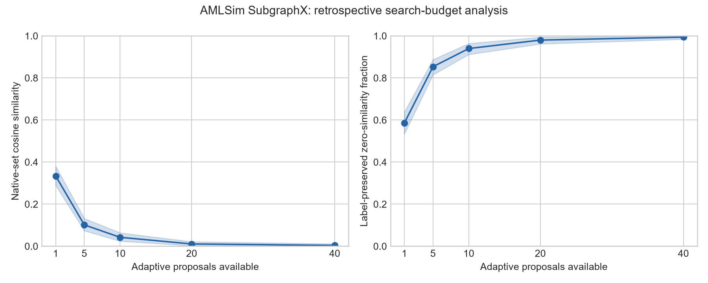

# AMLSim SubgraphX search-budget analysis

**COMPLETE: 166 targets, three source trials, 498 saved attack trajectories.**

Retrospective prefixes of the same adaptive searches; the final result matches saved selected attacks. Intervals resample targets with their three trials together. These are conditional descriptive intervals; graph dependence and classifier-training uncertainty are not modeled.

| Proposals | Similarity (95% interval) | Label-preserved zero similarity (95% interval) | Mean unique proposals |
|---:|---:|---:|---:|
| 1 | 0.3340 (0.2886, 0.3804) | 58.63% (53.41, 63.86) | 1.00 |
| 5 | 0.1015 (0.0735, 0.1321) | 85.34% (81.53, 88.76) | 5.00 |
| 10 | 0.0423 (0.0241, 0.0641) | 93.98% (91.16, 96.39) | 10.00 |
| 20 | 0.0108 (0.0026, 0.0217) | 97.99% (96.18, 99.40) | 19.99 |
| 40 | 0.0039 (0.0000, 0.0116) | 99.40% (98.39, 100.00) | 39.92 |

All selected prefix candidates preserve labels in these cases. First-success data retain failures as censored, not as success at proposal 40. Unique proposal counts cover the adaptive trace only, excluding clean explanations and other methods. A zero set cosine can include an empty explanation and does not establish incorrectness. Random-search prefix scores were not saved; this curve cannot show adaptive superiority. The ongoing HI-Small experiment is excluded.

